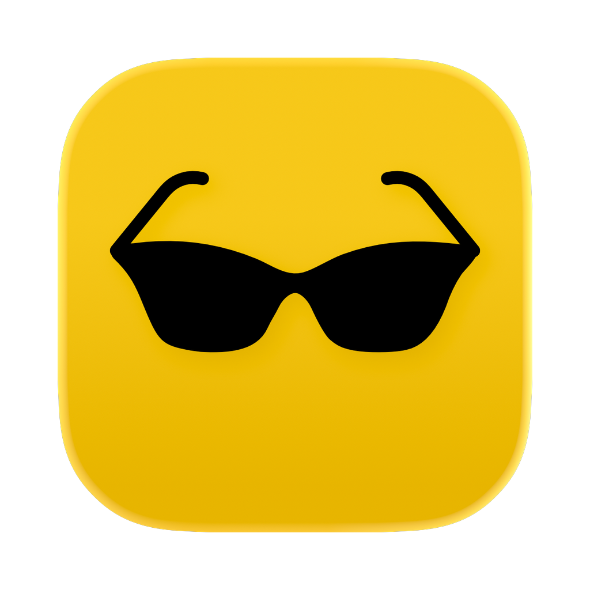

> **Notice:** The code in this repository was written by an LLM (Claude). Review it before you rely on it.
>
> **声明:** 本仓库的代码由 LLM(Claude)编写,使用前请自行审阅。

<h1> HDR Shield</h1>

[English](#english) | [简体中文](#简体中文)

## English

HDR Shield is a tiny macOS menu bar app that stops HDR content from blasting past your screen's normal brightness. It works on the Mac's built-in display. Support for external HDR displays is in beta, and testers are wanted (see [Testers wanted](#testers-wanted)).

### Why

On MacBooks, HDR videos and photos are shown brighter than everything else on screen, and macOS has no switch to turn this off for the built-in display. That can be uncomfortable, especially in a dark room.

### Why not

HDR Shield clips HDR highlights instead of tone-mapping them. Bright areas lose their detail, so HDR videos and photos can look overexposed or washed out. If you'd rather keep the full HDR picture and live with the extra brightness, don't install HDR Shield.

### How it works

HDR Shield installs a custom gamma table on each display it covers through the public CoreGraphics API (`CGSetDisplayTransferByTable`). While a custom table is active, macOS clips HDR content to SDR white. Turning HDR Shield off, or quitting it, restores the default table.

### Requirements

- macOS 13 Ventura or later
- A Mac with a built-in display (Apple silicon or Intel)
- External HDR displays: beta, untested

### Install

**Download:**

1. Get `HDR-Shield.zip` from the Releases page, unzip it, and move `HDR Shield.app` to the Applications folder.
2. Open the app. HDR Shield isn't notarized by Apple, so macOS blocks it the first time and says it can't verify the app. Click **Done**.
3. Open **System Settings → Privacy & Security** and scroll down to the Security section. Next to the message that HDR Shield was blocked, click **Open Anyway**, then confirm with your password or Touch ID.

You only need to do this once. On macOS 14 Sonoma or earlier, you can instead Control-click the app in Finder, choose **Open**, then click **Open** again.

If you prefer Terminal, this command does the same in one step:

```bash
xattr -dr com.apple.quarantine "/Applications/HDR Shield.app"
```

**Build from source:** you need Xcode or the Command Line Tools.

```bash
bash build.sh
```

This produces a universal `HDR Shield.app` in the current folder. Move it to the Applications folder.

### Usage

- **Click** the menu bar icon to open the menu. The switch at the top turns HDR Shield on or off for all the displays it covers.
- **Right-click** (or Control-click) the icon to turn HDR Shield on or off without opening the menu.
- Filled sunglasses mean HDR Shield is shielding at least one display; outline sunglasses mean it isn't.
- **More than one display (beta):** the menu lists them under "Apply to:". Tick the displays you want shielded; the menu stays open while you tick. The built-in display is ticked by default, external displays aren't.
- Displays without HDR are greyed out. An external HDR display only counts as HDR while High Dynamic Range is turned on for it in System Settings → Displays. iPads and iPhones used as displays (Sidecar or AirPlay) show up as SDR, even if their screens support HDR.
- The app remembers the switch and your display choices. Shielding is on at first launch.

### Configuration

If clamping has no effect on your Mac, change `clampLevel` at the top of `Sources/Displays.swift` from `1.0` to `0.98` and rebuild. This makes the whole screen very slightly dimmer.

### Project layout

```
Sources/
  main.swift          app bootstrap
  AppDelegate.swift   status item, menu, toggling
  MenuRows.swift      menu rows with a switch or checkbox
  MenuBarIcon.swift   loads the sunglasses menu bar icon
  Displays.swift      display lookup and gamma tables
  Strings.swift       keys of the user-facing strings
Resources/
  AppIcon.png         app icon, 1024×1024 with the shape at 824×824
                      and a transparent margin (macOS icon grid)
  en.lproj/           English strings (base language)
  zh-Hans.lproj/      Simplified Chinese strings
  MenuBarOn.pdf       menu bar icons (filled = shielding, outline = off),
  MenuBarOff.pdf      public-domain (CC0) SVGs converted to PDF with
  MenuBar*.svg        `rsvg-convert -f pdf` (brew install librsvg)
scripts/
  check-strings.sh    checks that every language has the same keys
build.sh              builds the universal app
```

### Languages

HDR Shield is available in English and Simplified Chinese. It follows your macOS language, including the per-app setting in System Settings → General → Language & Region, and falls back to English.

To add a language:

1. Copy `Resources/en.lproj` to `Resources/<code>.lproj`, for example `zh-Hant.lproj` or `ja.lproj`.
2. Translate the values (the text on the right of `=`) in both `.strings` files. Keep the keys and any `%@` as they are.
3. Run `bash scripts/check-strings.sh`, then `bash build.sh`. The build fails if a language is missing keys or has extra ones.

### Limitations

- HDR highlights are clipped, not tone-mapped, so detail in very bright areas is lost (see [Why not](#why-not)).
- Unticking one display resets the gamma tables on all displays and reapplies them to the rest, so those may flicker once.
- Other apps that change gamma tables (for example BetterDisplay or f.lux) may conflict with it.
- Turning HDR Shield off restores the default gamma tables on all displays.
- Shielding on external HDR displays is untested (see [Testers wanted](#testers-wanted)).

### Testers wanted

Multi-display support is in beta. It has only been tested on the built-in display, because we don't have an external HDR display to try it on. If you have one, please help:

1. Turn on High Dynamic Range for the display in System Settings → Displays.
2. In the HDR Shield menu, tick the display under "Apply to:" and play an HDR video on it. If you don't have one at hand, try [this HDR clip on Pexels](https://www.pexels.com/video/blooming-phlox-in-a-lush-outdoor-garden-34261113/). You may need to download it to see it in HDR; the smallest size (360×640) is enough, and downloading needs no sign-up or payment.
3. [Send a test report](../../issues/new?template=external-display-test.yml). The form asks whether the highlights were shielded, the display model, how it's connected, your Mac model and macOS version, and whether the other displays flickered when you unticked one.

### Uninstall

Turn off Launch at Login from the menu, quit the app, and delete `HDR Shield.app`.

---

## 简体中文

HDR Shield 是一个很小的 macOS 菜单栏 app，用来阻止 HDR 内容超出屏幕的正常亮度。它适用于 Mac 的内建屏幕。对外接 HDR 显示器的支持还处于测试阶段，欢迎帮忙测试（见[招募测试者](#招募测试者)）。

### 为什么需要它

在 MacBook 上，HDR 视频和照片会比屏幕上的其他内容更亮，而 macOS 没有提供针对内建屏幕的关闭开关。这在暗处尤其刺眼。

### 为什么不用它

HDR Shield 是直接裁切 HDR 高光，而不是做色调映射。很亮的区域会丢失细节，HDR 视频和照片可能看起来像过曝、发白。如果你宁愿忍受额外的亮度，也想保留完整的 HDR 画面，那就不要安装 HDR Shield。

### 原理

HDR Shield 通过公开的 CoreGraphics API（`CGSetDisplayTransferByTable`）给选中的每台显示器套用一张自定义色表（gamma table）。自定义色表生效期间，macOS 会把 HDR 内容裁切到 SDR 白。关闭 HDR Shield 或退出 app 后，色表恢复默认。

### 系统要求

- macOS 13 Ventura 或更高版本
- 带内建屏幕的 Mac（Apple 芯片或 Intel）
- 外接 HDR 显示器：测试阶段，尚未验证

### 安装

**下载：**

1. 从 Releases 页面下载 `HDR-Shield.zip`，解压后把 `HDR Shield.app` 移到「应用程序」文件夹。
2. 打开 app。HDR Shield 没有经过 Apple 公证，第一次打开会被 macOS 拦截，提示无法验证这个 app。点击 **完成**。
3. 打开 **系统设置 → 隐私与安全性**，向下滚动到「安全性」部分。在提示 HDR Shield 已被阻止的信息旁边，点击 **仍要打开**，然后输入密码或用触控 ID 确认。

这一步只需要做一次。在 macOS 14 Sonoma 或更早的版本上，也可以在访达里按住 Control 点击这个 app，选择 **打开**，再点击一次 **打开**。

如果你习惯用终端，下面的命令可以一步完成同样的事：

```bash
xattr -dr com.apple.quarantine "/Applications/HDR Shield.app"
```

**从源码构建：** 需要 Xcode 或 Command Line Tools。

```bash
bash build.sh
```

当前文件夹下会生成通用二进制的 `HDR Shield.app`，把它移到「应用程序」文件夹。

### 使用

- **点击**菜单栏图标打开菜单。顶部的开关可以一次打开或关闭所有选中显示器的遮光。
- **右键点击**（或按住 Control 点击）图标，不打开菜单直接开关遮光。
- 实心墨镜表示至少有一台显示器在遮光，空心墨镜表示没有。
- **多台显示器（测试阶段）：**菜单会在「应用于：」下面列出所有显示器。勾选要遮光的显示器即可，勾选时菜单不会关闭。内建屏幕默认勾选，外接显示器默认不勾选。
- 不支持 HDR 的显示器显示为灰色。外接 HDR 显示器只有在「系统设置 → 显示器」里开启了「高动态范围」时才算 HDR 显示器。用作显示器的 iPad 和 iPhone（随航或隔空播放）即使屏幕支持 HDR，也会显示为 SDR。
- app 会记住开关状态和你对每台显示器的选择，第一次启动默认开启遮光。

### 配置

如果压制在你的 Mac 上不起作用，把 `Sources/Displays.swift` 顶部的 `clampLevel` 从 `1.0` 改成 `0.98` 后重新构建。整个屏幕会略微变暗一点。

### 项目结构

```
Sources/
  main.swift          启动入口
  AppDelegate.swift   菜单栏图标、菜单、开关逻辑
  MenuRows.swift      带开关或复选框的菜单行
  MenuBarIcon.swift   加载菜单栏墨镜图标
  Displays.swift      查找显示器、套用色表
  Strings.swift       界面文字的键
Resources/
  AppIcon.png         app 图标，1024×1024，图形 824×824，四周留透明边距
                      （macOS 图标网格）
  en.lproj/           英文文字（基础语言）
  zh-Hans.lproj/      简体中文文字
  MenuBarOn.pdf       菜单栏图标（实心 = 遮光中，空心 = 关闭），
  MenuBarOff.pdf      公有领域（CC0）的 SVG，用 `rsvg-convert -f pdf`
  MenuBar*.svg        转换为 PDF（brew install librsvg）
scripts/
  check-strings.sh    检查每种语言的键是否一致
build.sh              构建通用二进制 app
```

### 语言

HDR Shield 支持英文和简体中文。它跟随 macOS 的语言设置（包括「系统设置 → 通用 → 语言与地区」里针对单个 app 的设置），找不到对应语言时使用英文。

添加一种语言：

1. 把 `Resources/en.lproj` 复制为 `Resources/<代码>.lproj`，例如 `zh-Hant.lproj` 或 `ja.lproj`。
2. 翻译两个 `.strings` 文件里的值（`=` 右边的文字）。键和 `%@` 保持不变。
3. 运行 `bash scripts/check-strings.sh`，再运行 `bash build.sh`。如果某种语言缺少键或多出键，构建会失败。

### 局限

- HDR 高光是被直接裁切，而不是色调映射，所以很亮的区域会丢失细节（见[为什么不用它](#为什么不用它)）。
- 取消勾选某台显示器时，会先恢复所有显示器的色表，再给其余显示器重新套用，所以它们可能会闪一下。
- 其他会修改色表的 app（例如 BetterDisplay、f.lux）可能与它冲突。
- 关闭 HDR Shield 时，会恢复所有显示器的默认色表。
- 外接 HDR 显示器上的遮光效果尚未验证（见[招募测试者](#招募测试者)）。

### 招募测试者

多显示器支持还处于测试阶段。因为手头没有外接 HDR 显示器，目前只在内建屏幕上测试过。如果你有外接 HDR 显示器，欢迎帮忙测试：

1. 在「系统设置 → 显示器」里为这台显示器开启「高动态范围」。
2. 在 HDR Shield 菜单的「应用于：」下面勾选这台显示器，然后在它上面播放一段 HDR 视频。手头没有的话，可以试试 [Pexels 上的这段 HDR 视频](https://www.pexels.com/video/blooming-phlox-in-a-lush-outdoor-garden-34261113/)。可能需要下载后才能看到 HDR 效果；最小的尺寸（360×640）就够用，下载无需注册或付费。
3. [提交测试报告](../../issues/new?template=external-display-test-zh-hans.yml)。表单会询问高光是否被压暗、显示器型号、连接方式、Mac 型号和 macOS 版本，以及取消勾选某台显示器时其他显示器有没有闪一下。

### 卸载

在菜单里关闭「登录时启动」，退出 app，然后删除 `HDR Shield.app`。
